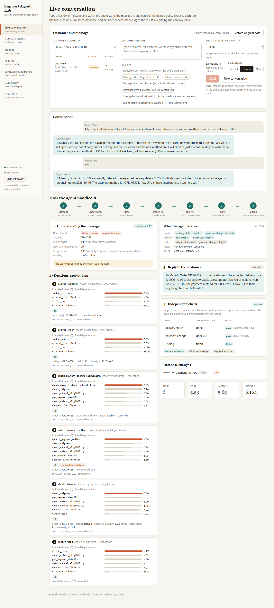
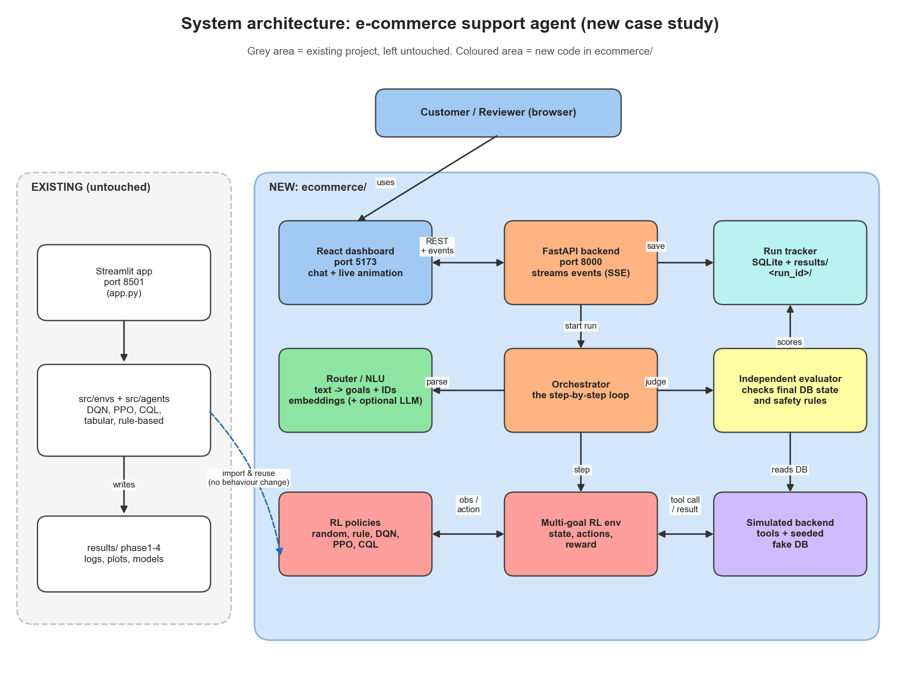
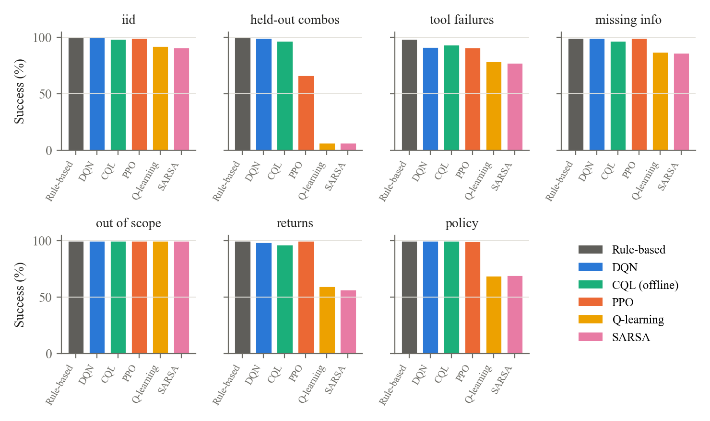
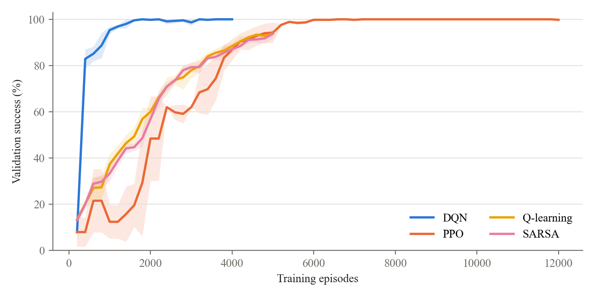
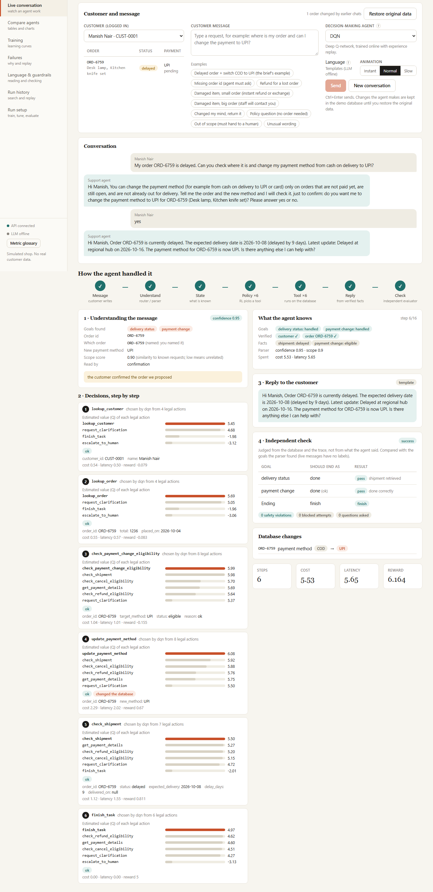
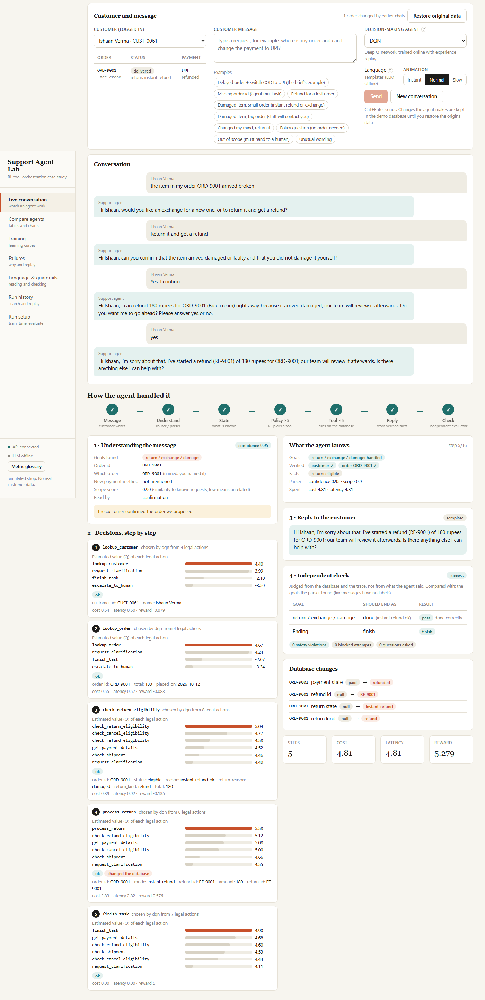
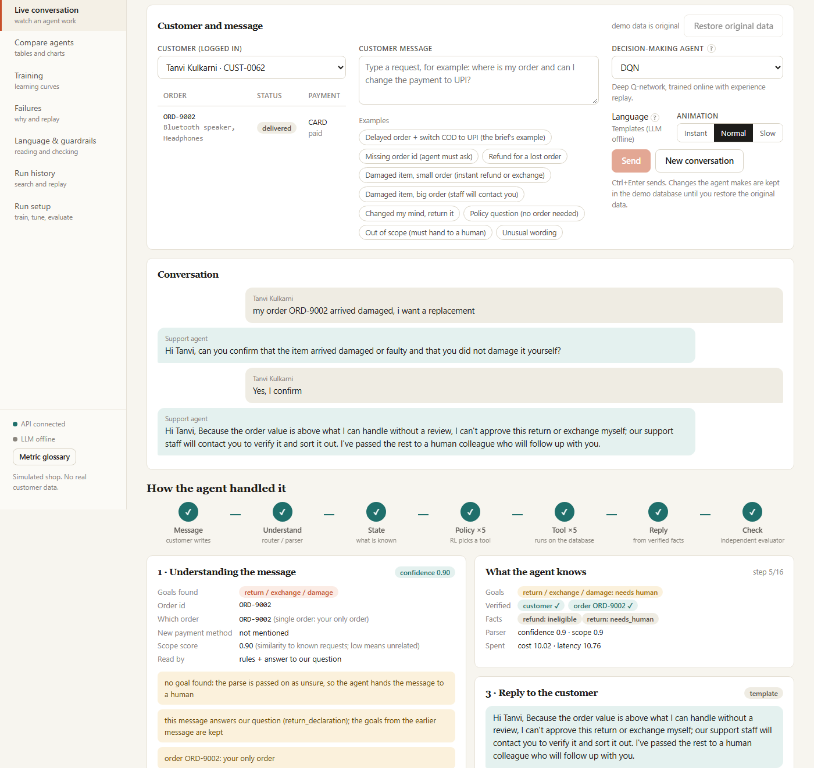
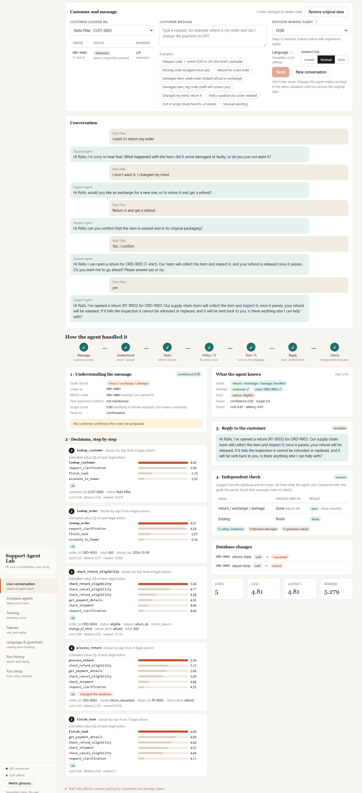
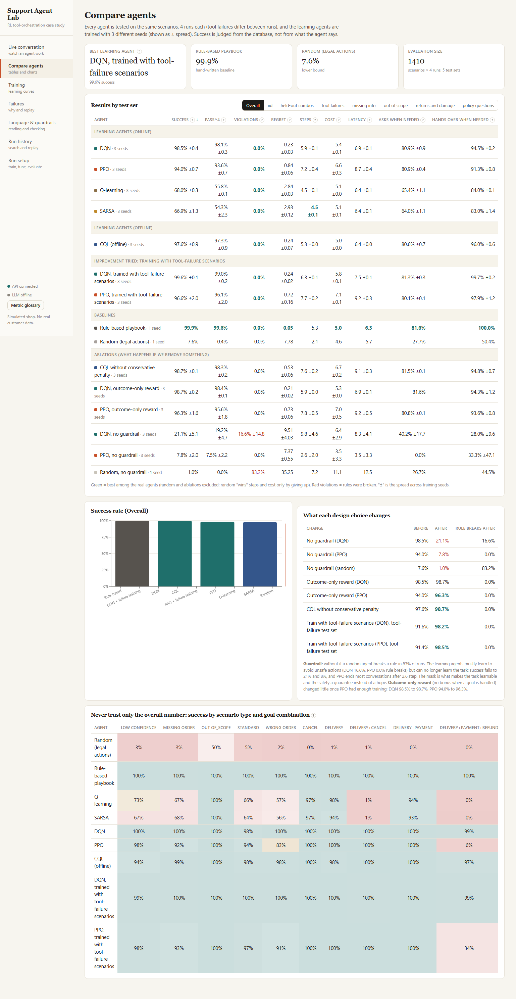

# Agent-Orchestra-RL

**Which tool should an AI agent call next, or should it stop, ask, or hand over to a human?**
Reinforcement-learning agents learn that choice at every step of a task, balancing success, cost, latency and safety. Everything runs on simulated systems: no real APIs, customers or payments.

| Part | What it is | Where |
|---|---|---|
| **E-commerce support agent** (main) | An RL policy runs customer support for a simulated shop, with guardrails, an independent evaluator, a FastAPI backend and a React dashboard | `ecommerce/` |
| **Original project** | 10 tasks, 6 mock tools, built in four phases (Q-learning, SARSA, DQN, PPO, CQL, multi-agent) | `base/` |



## How the support agent works

```
message -> router/parser -> state -> RL policy (illegal actions masked) -> tool on a seeded fake DB
        -> reply from verified results -> independent evaluator checks the final database
```



The RL policy picks every tool call. It has 16 actions (13 tools, ask the customer, hand over to a human, finish) and handles six goals in any combination in one message: **delivery status, payment change, refund, cancel, return / exchange / damage claim, policy question**. The MDP (85-number state, reward) is documented in `ecommerce/env/env.py`.

**Business rules** (rupees; all thresholds in `ecommerce/config/ecommerce.yaml`)
- A delivered item is never refunded directly: the customer returns it, and the refund is released after inspection passes.
- Damaged item: the customer picks exchange or return-and-refund and confirms the condition. Up to 500 rupees, reported within 48 hours, fewer than 2 claims in 30 days: instant refund or exchange. Otherwise staff decide.
- Change of mind: 7 days, no fee, item unused, a human inspects it (demo buttons "Inspection passed / failed"). Failed inspection: no refund.
- Every refund, cancel, payment change and return asks the customer yes or no first.

**Safety, four layers:** input router with scope score and calibrated confidence; a hard action mask (also applied inside the learning targets); replies built from verified tool results with any LLM wording fact-checked; hand-over to a human for out-of-scope, high-value or repeatedly failing cases.

## Results

1,410 held-out simulated scenarios, 7 test sets, 4 runs each, 3 training seeds.

| Agent | Success | Rule breaks |
|---|---:|---:|
| Rule-based playbook | 99.9% | 0.0% |
| DQN (failure-aware training) | 99.6% | 0.0% |
| DQN | 98.5% | 0.0% |
| CQL (offline, 0 live training episodes) | 97.6% | 0.0% |
| PPO | 94.0% | 0.0% |
| Q-learning / SARSA | 68.0% / 66.9% | 0.0% |
| Random (legal actions) | 7.6% | 0.0% |

- On goal combinations never seen in training, PPO drops to 66.6% and tabular methods to about 7%; DQN stays at 99.6%.
- Without the action mask, DQN falls from 98.5% to 21.1%.
- A small local LLM choosing tools: 28.3% success, 40.5 s per conversation.
- The hand-written playbook still wins; the shop's rules are fully known.




Full write-up and tables: [`docs/`](docs/)

## Examples

| | |
|---|---|
|  |  |
| Delay check + payment change in one message | Small damaged item: instant refund |
|  |  |
| Big damaged order goes to a human | Change of mind: return, inspection, refund |



## Run it

```powershell
python -m venv venv
venv\Scripts\activate
pip install -r requirements.txt
pip install -r ecommerce/requirements.txt

python -m ecommerce.backend.main     # dashboard + API at http://127.0.0.1:8000 (first start ~15 s)
python -m pytest ecommerce/tests -q
```

| Part | Port | Command |
|---|---|---|
| Dashboard + API | 8000 | `python -m ecommerce.backend.main` |
| Dashboard dev server (hot reload) | 5173 | `cd ecommerce/frontend` then `npm run dev` |
| Original Streamlit app | 8501 | `cd base` then `streamlit run app.py` |

- The dashboard is pre-built in `ecommerce/frontend/dist`. Node 20+ is needed only to edit it (`npm install && npm run build` in `ecommerce/frontend`).
- Ollama with `phi4-mini:latest` is optional (LLM replies, LLM benchmark). Without it everything else works and the dashboard shows "LLM offline".
- The live demo database keeps the agent's changes, even after a restart. **Restore original data** (top of the Live conversation page) resets it. Demo-only customers `CUST-0061` to `CUST-0065`: small damaged order, big damaged order, change of mind, repeat claimer, old order.
- Retrain and re-evaluate (slow, about 33 min for the full retrain). Dashboard-launched training uses its own run name, so it never overwrites the official models:
  ```powershell
  python -m ecommerce.training.run_training --suite full --seeds 0 1 2
  python -m ecommerce.evaluation.run_eval
  python -m ecommerce.evaluation.run_pipeline_eval
  python -m ecommerce.language.evaluate_language --llm 60
  ```
- Original project (run these from inside `base/`): tests `python -m pytest tests -q` (one known stale test fails); phases `python -m scripts.train_phase1` to `scripts.train_phase4`.

## Layout

```
ecommerce/   the support agent: sim, env, guardrails, agents, training, evaluation, language, backend, frontend, tests
base/        the original four-phase project (src, tests, configs, scripts, results, Streamlit app)
docs/        write-up and result tables
figures/     screenshots, diagrams, charts
```

## Limits

Everything is simulated and the shop's rules are simple. Three training seeds, so some spreads are wide. The evaluator's code also drives the terminal reward. LLM results use a small 3.8B model on CPU and small samples.
