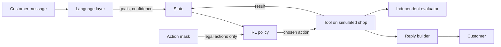

# Architecture, design and trade-offs

## 1. What the system does

An agent has to resolve a customer's request by choosing, step by step, which tool to call, whether to ask the customer a question, or whether to hand over to a human. A reinforcement-learning policy makes these choices. The goal is to finish the request correctly at low cost and low latency, without ever breaking a business rule.

Everything runs on a simulated shop. The customers, orders, payments and tools are fake, and the same seed always produces the same world.

There are two parts:
- **The original benchmark:** a small simulated tool-orchestration task (10 task types, 6 mock tools) used to compare tabular Q-learning, SARSA, DQN, PPO, offline CQL and a multi-agent extension.
- **The customer-support case study:** a much more realistic system built on the same ideas. This is the main use case and the focus of this document.

## 2. The big picture

The loop runs until the agent finishes, hands over to a human, or reaches the step limit. After that, a separate evaluator judges the final state of the shop's database.

## 3. Components

### Language layer
Turns free text into structured goals. An embedding-based router matches the message to the six goals (delivery status, payment change, refund, cancel, return or damage claim, policy question), gives a scope score and a calibrated confidence, and repairs typos. An optional local LLM also reads the message, and the router cross-checks it. A resolver then works out which order the customer means: one they named, one from the recent conversation, their only order, or one inferred from the goal.

The policy never sees text. It only sees the structured result.

### State
A vector of 85 numbers: which goals were found, handled or need a human; whether the customer and order are verified; what each tool has revealed; whether the customer still owes an answer (a payment method, the return reason); failures per tool; steps and cost used; the parser's confidence and scope score; and the last action. It contains no hidden ground truth.

### Actions
Sixteen discrete actions: thirteen tools (customer and order lookup, shipment check, payment details and change, refund, cancel and return eligibility and execution, policy lookup), plus ask the customer, hand over to a human, and finish. The policy picks the tool. The environment fills in the arguments (order id, the customer's answers, the policy topic) from verified context, so the policy can never invent or mistype one.

### Action mask
The safety core. It computes from the state which actions are legal. A state-changing tool is legal only with a verified order, a passed eligibility check, a matching customer request and, for payments and returns, the answers only the customer can give. Retries are capped, after which a human takes over. The mask is applied when the agent acts and also inside the learning targets, so the agent never learns from actions it cannot take.

### RL policy
The decision-maker. Several are compared: random over legal actions, a hand-written rule-based playbook, tabular Q-learning and SARSA on a compressed state, DQN, PPO, and CQL trained offline from a fixed log of past conversations. An oracle with access to the hidden truth exists only to measure regret and to test the environment.

### Simulated shop and tools
A seeded fake database of customers, orders, shipments and payments. Tools read and change it using real business rules, with random failures and sometimes a tool that is down. Tools re-check the rules before touching the database as a second line of defence.

### Reply builder
Builds the customer reply from verified tool results using templates. An optional LLM can reword it, but every draft is fact-checked for invented ids, dates, numbers, claims, wrong currency and flipped meaning, and is replaced by the template if anything fails. Questions to the customer and policy answers are never LLM-worded.

### Independent evaluator
Decides success from the scenario's ground truth, the final database state and the trace, never from the agent's own words. Success means every goal reached its correct outcome (done, correctly declined, or handed to a human), the run ended the right way, and no rule was broken.

### Backend and dashboard
A web API runs the loop and emits one event per stage (parse, state, decisions, tools, reply, evaluation), streamed to the browser and stored in a database so any run can be replayed. A dashboard shows the live conversation, agent comparison, training curves, failed runs with replay, and the language and guardrail results.

## 4. The decision problem

- **Episode:** starts with a message, ends when the agent finishes, hands over, or reaches 16 steps.
- **Reward:** small penalties for cost and latency on each step, plus one point for each goal handled. At the end, plus 5 for a fully correct run or minus 2 otherwise, decided by the evaluator. Minus 5 for each executed rule violation, and small penalties for blocked or unneeded actions.
- **Business rules the agent must respect:**
  - Payment can change only on an unpaid open order, and only to a method the customer named.
  - A delivered item is never refunded directly. The customer returns it first, and the refund follows once it passes inspection.
  - Cancellation is possible only before shipping.
  - A damaged item up to a value limit, reported in time and with little claim history, gets an instant refund or exchange. Everything else goes to staff.
  - Every refund, cancel, payment change and return asks the customer yes or no first.

## 5. Safety design

Four layers, each independent of the others:
1. **Input:** the router's scope score and confidence catch out-of-scope or unclear messages.
2. **Actions:** hard rules in code make illegal actions impossible for any policy.
3. **Output:** replies come from verified results and LLM wording is checked.
4. **Escalation:** out-of-scope requests, large refunds, damage claims needing review and repeated tool failures go to a human.

The same idea runs through all four: safety comes from the code around the policy, not from trusting the policy.

## 6. Design decisions and trade-offs

**RL chooses the tools; the LLM only reads and words.**
Gain: decisions are fast, consistent and testable. A small local LLM choosing tools scored 28% and took about 40 seconds per conversation, against under a tenth of a second for the RL policy.
Cost: the language layer is the least reliable part, and language errors cost the agents up to 8 points end to end.

**Hard rules in the action mask, not in the policy.**
Gain: zero rule violations for every guarded agent, and the task becomes learnable. Without the mask, DQN fell from 98.5% to 21.1%.
Cost: the rules must be written by hand, so the agent cannot discover better rules on its own.

**The policy reads state, not text.**
Gain: any wording with the same goals gives the same behaviour, and honest tests on unseen wording become possible.
Cost: all language understanding errors happen before the policy and cannot be recovered by it.

**Mostly outcome-based reward, judged by an independent evaluator.**
Gain: the agent is rewarded for the real result, and the evaluator cannot be fooled by the agent's claims.
Cost: the evaluator's logic also shapes the terminal reward, so agents are optimised for what it measures. Removing the per-goal bonus changed little, so dense shaping was not needed here.

**The environment fills in tool arguments.**
Gain: the policy cannot invent or mistype an id, a payment method or a policy topic.
Cost: a smaller action space also means less flexibility.

**Confirmation before money-changing actions happens in the chat layer, not as an RL action.**
Gain: simple, reliable, easy to explain.
Cost: the agent does not learn when to confirm.

**Offline RL (CQL) as an option.**
Gain: learns from a fixed log with no live episodes and reached 97.6%.
Cost: it is weakest at knowing when a human must decide, because those cases are rare in the log.

**Tabular methods on a compressed state.**
Gain: a simple baseline that shows what function approximation buys.
Cost: they fail on unseen goal combinations and need many more episodes.

**Separate wording sets for the language layer.**
One set for examples, one for tuning and one for the final test, so language results are not inflated by tuning on the test wording.

**Demo database that keeps changes, with a restore button.**
Evaluation runs on frozen copies. The interactive demo keeps changes so multi-step conversations make sense.

## 7. Evaluation design

- **Seven test sets:** ordinary scenarios, goal combinations never seen in training, tool failures, missing or wrong order ids, out-of-scope messages, returns and damage claims, and policy questions. A separate set of unseen wording tests the real language pipeline.
- **Repeats and seeds:** four runs per scenario and three training seeds per learning agent. Each test set has its own seed range, and a check confirms that no scenario is shared.
- **Metrics:** success, consistency (solved in all four runs), safety violations, regret against the oracle, steps, cost, latency, and the quality of asking and handing over.
- **Sanity checks:** the oracle and the rule-based playbook score 100% on every set when tool failures are switched off, which shows the task is solvable and the environment is consistent.

## 8. What the architecture does and does not give

**It gives:** safe behaviour by construction, results that can be reproduced, an evaluation that exposed gaps the headline number hid (for example PPO failing on unseen goal combinations while DQN did not), and a clear separation between language, decision and checking.

**It does not give:**
- A real deployment. Real traffic would need privacy handling, monitoring and integration with real systems.
- Proof that RL beats rules. The hand-written playbook scored highest, because the shop's rules are simple and fully known.
- Generalisation beyond the six goals and the five held-out combinations tested.
- Any user study.

## 9. The original benchmark in brief

The first project used the same RL loop on a smaller problem: 10 task templates, 6 mock tools with a cost, latency and success probability each, a 20-number state (task, tools tried, tools succeeded, budget left, steps left) and 7 actions (six tools plus stop). The reward was a success bonus scaled by quality, minus cost and latency penalties, minus a failure penalty.

It was built in four phases: rule-based, tabular Q-learning and SARSA; DQN; PPO and offline CQL; and a two-agent version where a triage agent can delegate heavy tools to an execution agent. Its main lessons carried into the case study: report results per task rather than only overall, keep a model tied to the exact state layout it was trained on, and use an oracle to measure regret.
